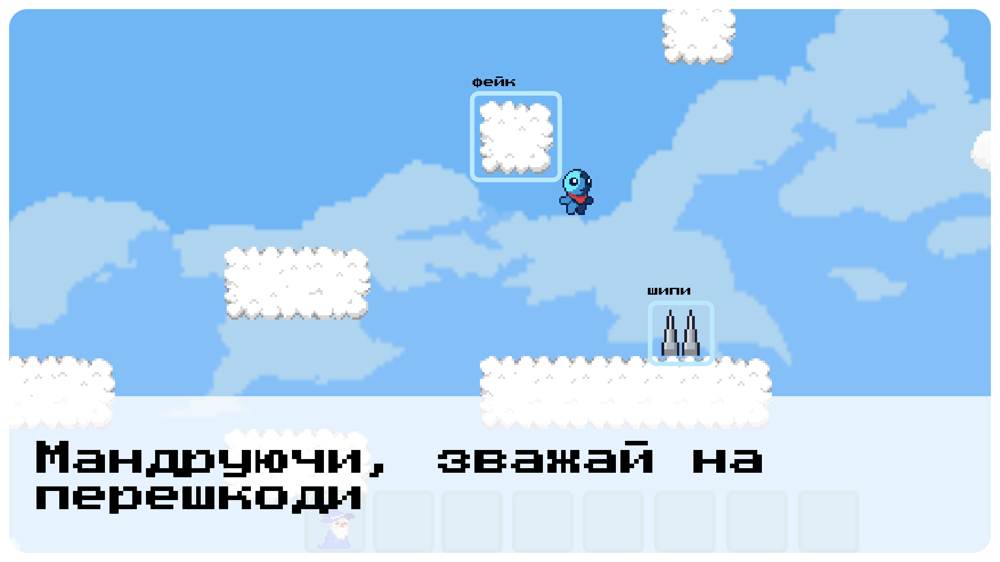
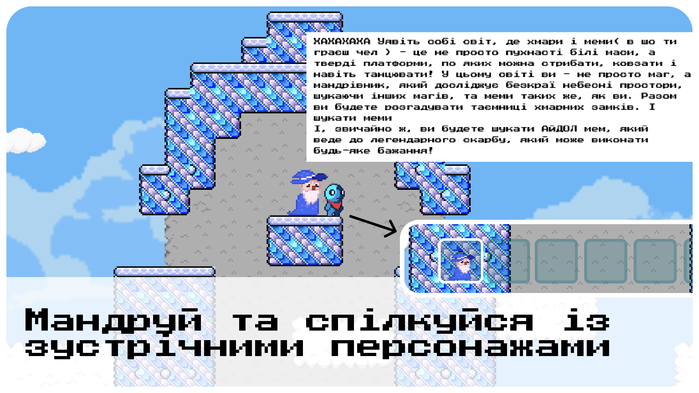
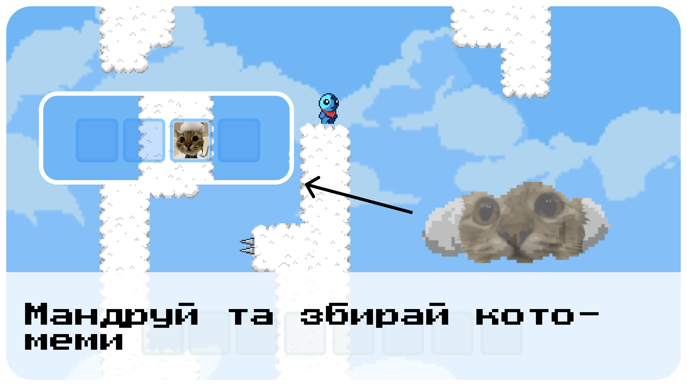
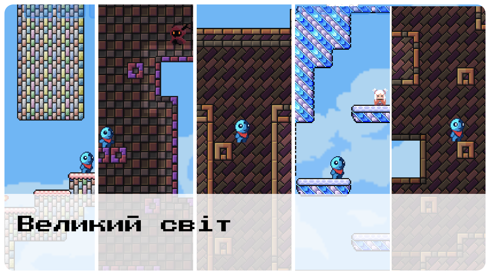
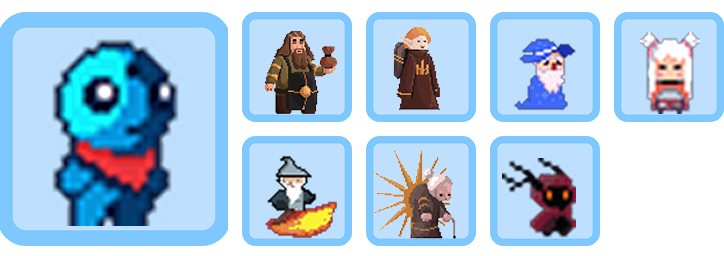

# ☁️ In Search of IDOL (In Search of IDLE)

  

  <b>Іронічний атмосферний 2D-платформер у світі небесних замків, хмар та мемів.</b>

  
  
  
  

---

## 🏆 Про проєкт та Game Jam

Гра була розроблена всього за **3 дні** в рамках хакатону **GoITeens Game Jam**, де посіла **🥈 2-е призове місце** серед десятків інших робіт!

> 🎮 **Сторінка гри на Itch.io:** [mylian.itch.io/in-search-of-idol](https://mylian.itch.io/in-search-of-idol)  
> Тут можна зіграти прямо у браузері або завантажити готові збірки для **Windows** та **macOS**.

---

## 📖 Сюжет та Лор

> *«Уявіть собі світ, де хмари і меми — це не просто пухнасті білі маси, а тверді платформи, по яких можна стрибати, ковзати і навіть танцювати! У цьому світі ви — не просто маг, а мандрівник, який досліджує безкраї небесні простори, шукаючи інших магів та меми. Разом ви розгадуватимете таємниці хмарних замків і шукатимете легендарний АЙДОЛ мем, здатний виконати будь-яке бажання!»*

Ви граєте за відважного блакитного мандрівника у червоному шарфі, який долає небезпечні висоти, розкриває секрети повітряних замків та збирає найрідкісніші кото-меми небесного світу.

---

## 🎮 Ігровий функціонал та механіки

### 1. Зважай на небезпечні перешкоди
Світ хмар підступний: далеко не кожна хмаринка витримає вашу вагу, а на вершинах чекають гострі шипи та провалля.

* **Фейкові платформи:** хмари-пастки, крізь які гравець провалюється вниз.
* **Шипи та смертельні пастки:** помилка відкидає гравця на контрольний чекпоінт.
* **Динамічний таймер:** перевірте, наскільки швидко ви зумієте пройти всю смугу перешкод.

---

### 2. Спілкування із колоритними персонажами
Мандруючи просторами, ви зустрічатимете інших чарівників та жителів замків, які діляться підказками, жартами та історіями.

* Інтерактивна система діалогів при наближенні до персонажів.
* Слот-інвентар зустрінутих союзників та важливих знахідок.

---

### 3. Пошук та збирання кото-мемів
Хмари ховають у собі секрети — легендарні кото-хмаринки!

* Досліджуйте таємні куточки карти та відшукайте всі заховані кото-меми для заповнення колекції.

---

### 4. Великий та різноманітний світ
Локації гри постійно змінюються: від легких небесних хмар до похмурих веж, крижаних фортець та таємничих замкових залів.

---

## 👥 Персонажі та Юніти

У грі представлений головний герой та 7 унікальних колоритних персонажів зі своїм характером та зовнішністю:

* **Головний герой:** спритний мандрівник у червоному шарфі.
* **Торговець-гном:** зберігач скарбів та мішечків з золотом.
* **Ельф-мандрівник:** дослідник з похідним наплічником.
* **Мудрий маг хмар:** чарівник у класичному синьому гостроверхому капелюсі.
* **Жриця замку:** таємнича хранителька крижаних залів.
* **Чарівник на вогняному килимі:** літаючий маг висот.
* **Сонячний старійшина:** мудрець із золотим сонячним німбом та палицею.
* **Тіньовий дух:** загадкова рогата істота з палаючими очима.

---

## 🕹️ Керування

| Дія | Клавіші |
|---|---|
| **Рух ліворуч** | <kbd>A</kbd> або <kbd>←</kbd> |
| **Рух праворуч** | <kbd>D</kbd> або <kbd>→</kbd> |
| **Стрибок** | <kbd>W</kbd>, <kbd>Space</kbd> або <kbd>↑</kbd> |
| **Повноекранний режим** | <kbd>F11</kbd> / Налаштування |

---

## 🛠️ Технології розробки

* **Рушій:** [Godot Engine 4.2+](https://godotengine.org/)
* **Мова:** GDScript
* **Рендерер:** Compatibility (GLES3 / WebGL)
* **Арт & Анімації:** Pixel Art (2D)
* **Платформи експорту:** Web (HTML5/Wasm), Windows (x86_64), macOS (dmg/app)

---

## 🚀 Встановлення та запуск проєкту

### Запуск із вихідного коду:
1. Завантажте та встановіть **Godot Engine 4.2** або новішу версію.
2. Склонуйте або завантажте цей репозиторій.
3. У Godot Project Manager натисніть **Import** і виберіть файл `project.godot` у папці репозиторію.
4. Натисніть **Edit**, а потім **F5** (або кнопку Run у правому верхньому куті), щоб розпочати гру!

---

  Зроблено з любов'ю та гумором на <b>GoITeens Game Jam</b> ❤️

